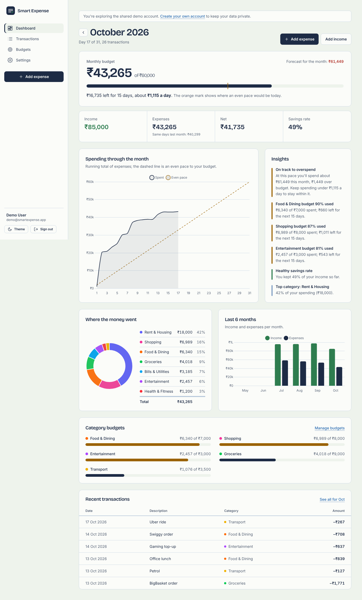
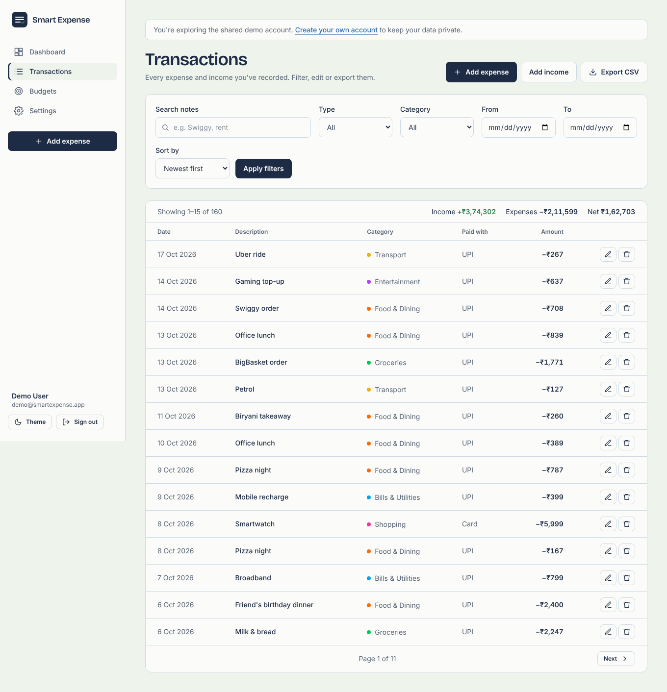
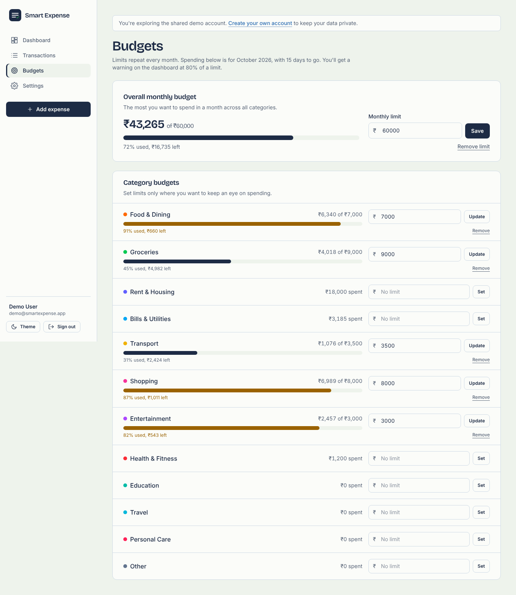
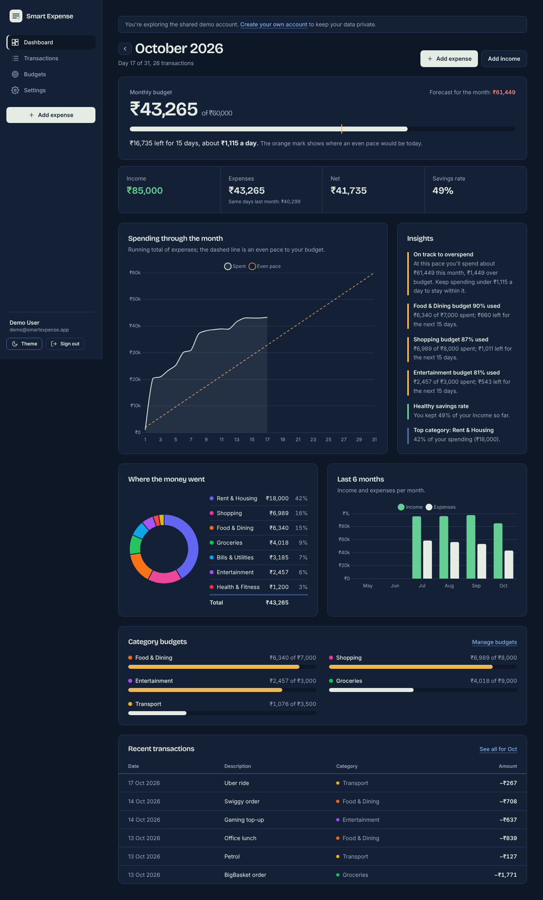

# Smart Expense & Budget Tracker

[](https://github.com/YOUR_GITHUB_USERNAME/smart-expense-tracker/actions/workflows/ci.yml)

A web app to record expenses and income, set monthly budgets per category, and get plain-language insights such as a month-end forecast, "spending is up 20% vs last month" or "Shopping budget 87% used".

**Live demo:** https://YOUR-APP.onrender.com. Click **Try the demo**; no sign-up needed.
<sub>Hosted on a free plan that sleeps when idle, so the first request can take up to a minute.</sub>



## Features

- **Expenses and income (full CRUD):** amount, category, date, payment method (UPI, card, cash...) and a note. Amounts are stored as integer paise, never floats.
- **Search, filter, sort, paginate:** by type, category, date range and note text. The totals follow the filter.
- **CSV export** of exactly what is filtered, safe against spreadsheet formula injection.
- **Monthly budgets:** one overall limit plus optional limits per category. They repeat every month and warn at 80%.
- **Dashboard:** budget bar with today's "even pace" marker, a daily allowance, income/expense/net/savings rate, a running-total chart against the budget pace, category doughnut, a 6-month trend and recent transactions.
- **Smart insights:** a forecast that doesn't extrapolate rent and bills, a fair comparison with the same days last month, category budget alerts, unusual spending vs the 3-month average, and savings rate.
- **Accounts:** register/login with bcrypt-hashed passwords, sessions stored in MongoDB, multiple currencies, password change.
- **One-click demo account** with 4 months of realistic sample data, refreshed automatically.
- **Responsive with dark mode;** keyboard and screen-reader friendly.

| Transactions | Budgets | Dark mode |
|---|---|---|
|  |  |  |

## Tech stack

| Layer | Technology |
|---|---|
| Server | Node.js 20+, Express 5 (MVC: routes → controllers → services → models) |
| Database | MongoDB with Mongoose 8 (schemas, validation, compound indexes, aggregation) |
| Views | EJS server-side templates, Tailwind CSS v4, Chart.js 4 |
| Auth & security | express-session + connect-mongo, bcryptjs, CSRF tokens, Helmet (strict CSP), express-rate-limit, express-validator |
| Tests | Jest + Supertest against a real MongoDB (88 tests) |
| DevOps | GitHub Actions CI (MongoDB service), Render (app), MongoDB Atlas (database) |

## Run it locally

You need **Node.js 20.12+** and a MongoDB database: either [MongoDB Community Server](https://www.mongodb.com/try/download/community) on your machine, or a free [MongoDB Atlas](https://www.mongodb.com/atlas) cluster (no install; see [DEPLOY.md](DEPLOY.md#1-database-mongodb-atlas)).

```bash
npm install
cp .env.example .env          # Windows: copy .env.example .env
# edit .env: set MONGODB_URI (and SESSION_SECRET)
npm run seed                  # optional: creates the demo account with sample data
npm run dev                   # http://localhost:3000 (auto-reload + CSS watch)
```

`npm start` runs without auto-reload. The compiled CSS (`public/css/app.css`) is committed, so the app works without a CSS build. Run `npm run build:css` after changing classes in views.

## Tests

```bash
npm test
```

The tests start a temporary MongoDB automatically (`mongodb-memory-server-core` downloads it on the first run), or use your own with `TEST_MONGO_URL=mongodb://127.0.0.1:27017 npm test`.

They cover:

- **Unit:** money parsing and formatting, dates and time zones, every insight rule, CSV escaping, safe redirects, and demo data.
- **Integration:** register/login/logout, session fixation, rate limiting, CSRF, CRUD, users being unable to touch each other's data (IDOR), filters, query injection, XSS escaping, CSV export, budgets, dashboard numbers, and the demo account.

## Project structure

```
server.js                  start-up: connect to MongoDB, session store, listen, graceful shutdown
src/
  app.js                   Express app: security headers, static files, sessions, CSRF, routes
  config/                  env settings, categories/currencies, DB connection
  models/                  User, Transaction, Budget (Mongoose schemas + indexes)
  routes/index.js          every URL in one place
  controllers/             auth, dashboard, transactions, budgets, settings
  services/
    analytics.js           MongoDB aggregations for the dashboard
    insights.js            "smart insights" rules (pure functions, unit-tested)
    csv.js                 CSV export with formula-injection protection
    demoData.js            realistic demo data + atomic reseeding
  middleware/              auth guards, CSRF, rate limits, validation, flash, errors
  utils/                   money (integer paise) and dates (UTC calendar days)
  styles/input.css         Tailwind source and design tokens
views/                     EJS pages and partials
public/                    compiled CSS, small browser scripts, favicon
scripts/seed.js            npm run seed
tests/                     unit + integration tests
```

## How it works

[docs/PROJECT_GUIDE.md](docs/PROJECT_GUIDE.md) explains the design decisions: money as integers, date handling, indexes, aggregation, the insight rules and security. It also has interview questions and answers.

## Deploy

Step by step in [DEPLOY.md](DEPLOY.md): MongoDB Atlas (free) → GitHub → Render (free), about 20 minutes.

## License

MIT
